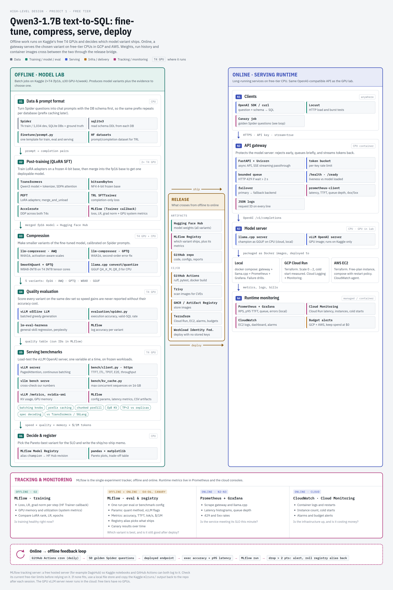

# Qwen post-training → compression → serving → deployment (free tier)

Fine-tune **Qwen3-1.7B** for text-to-SQL (Spider), compress it (AWQ / GPTQ / INT8 W8A8 / GGUF),
benchmark serving configurations with **vLLM** on a Kaggle **T4**, and deploy a containerized
service with a production gateway to **GCP Cloud Run** and **AWS EC2** via Terraform, all on
free-tier resources.

> Hardware honesty: GPU work (training, quantization, vLLM benchmarks) runs on Kaggle's free
> 2×T4. Free cloud tiers have no GPUs, so the cloud deployments serve the *same fine-tuned model*
> as a GGUF on CPU (llama.cpp). Every reported number states the hardware it came from.



## Status

| Week | Milestone | Status |
|---|---|---|
| 1 | T4 smoke test, baseline Spider eval, QLoRA SFT, merge | data audit done; GPU runs pending ([write-up](docs/weeks/week1.md)) |
| 2 | Streaming benchmark harness, KV-cache capacity model, T4 SLOs | harness + calculator ready |
| 3 | AWQ / GPTQ / W8A8 / GGUF + serving experiments (batching, prefix cache, chunked prefill, TP=2 vs replicas, spec decoding) | — |
| 4 | FastAPI gateway (auth, rate limit, 429 back-pressure, health/ready, metrics), Docker, compose + Prometheus/Grafana | — |
| 5 | Terraform: Cloud Run + EC2, CloudWatch / Cloud Monitoring, CI deploy, write-up | — |

## Layout

```
configs/      model ids, frozen benchmark workloads
finetune/     prompt format (shared by train/eval/bench), QLoRA SFT, LoRA merge
evaluation/   Spider execution accuracy, vLLM batch generation
bench/        async streaming load generator, latency metrics, KV-cache calculator
tracking/     MLflow logging helper (no-op unless MLFLOW_TRACKING_URI is set)
quantize/     llm-compressor recipes, GGUF export                       (week 3)
serving/      gateway + Dockerfiles + compose                           (week 4)
infra/        Terraform for GCP and AWS                                 (week 5)
notebooks/    thin Kaggle launchers; all logic lives in the packages above
reports/      CSVs, plots, decision memo, failure analysis
```

## Experiment tracking and monitoring

| Tool | Scope | Records | Question it answers |
|---|---|---|---|
| MLflow | offline + online | training curves (loss, LR, grad norm) + GPU system metrics; one run per eval/benchmark config (params, accuracy, TTFT, tok/s, CSVs); model registry alias `champion`; daily canary results | Is training healthy, which variant ships, and is it still good after deploy? |
| Prometheus + Grafana | online | gateway/llama.cpp latency histograms, queue depth, 429/5xx | Is the service meeting its SLO this minute? |
| CloudWatch / Cloud Monitoring | online: cloud | logs, restarts, instance count, cold starts, budget alerts | Is the infrastructure up and still free? |

Setup: `MLFLOW_TRACKING_URI` (+ username/password) turns on MLflow in `finetune.train_sft` (HF Trainer
callback), `evaluation.generate` and `bench.client`; unset, all tracking is a no-op. A free hosted MLflow server (e.g. DagsHub) lets Kaggle and
GitHub Actions log to the same place; verify its current free limits. On Kaggle, store keys as notebook Secrets.

Online → offline loop (week 5): a daily GitHub Actions job sends 50 golden Spider questions to the deployed
endpoint, logs execution accuracy and p95 latency to MLflow, and alerts / rolls back the registry alias on a
drop of more than 2 points.

## Quick start (local, CPU)

```bash
python -m venv .venv && .venv/bin/pip install -e '.[dev]'
.venv/bin/pytest -q
.venv/bin/python -m bench.kv_cache --model Qwen/Qwen3-1.7B --weight-gib 3.4
```

Spider data (pinned, checksum-verified): `python scripts/get_spider.py --out data`.

On Kaggle (GPU T4 ×2, internet on), import [notebooks/week1_kaggle.ipynb](notebooks/week1_kaggle.ipynb) and run all cells.

Weekly write-ups (what, why, results, interview notes): [docs/weeks/](docs/weeks/).

## Capacity model (first result)

Qwen3-1.7B: 28 layers × 8 KV heads × 128 head_dim → **112 KiB of KV cache per token** in fp16.
On a T4 (15 GiB usable, 0.9 utilization, 3.4 GiB fp16 weights, ~1 GiB activations) that's
~9.1 GiB of KV cache: **20 concurrent 4k-token sequences, or 5 at 16k**. The target of 32×4k
from the original plan therefore needs smaller weights (W4A16 ≈ 1.2 GiB) **and** a smaller KV
cache (fp8 KV, if the pinned vLLM supports it on sm75). Week 3 tests whether that holds.

## T4 (sm75) constraints that shape the experiments

- No bf16 → everything runs in fp16 (Qwen3 checkpoints are bf16; watch for overflow).
- No FlashAttention-2, no FP8 compute, no Marlin kernels → W4A16 uses slower non-Marlin paths.
- INT8 tensor cores **are** available → W8A8-INT8 (SmoothQuant + GPTQ) is a first-class candidate.
