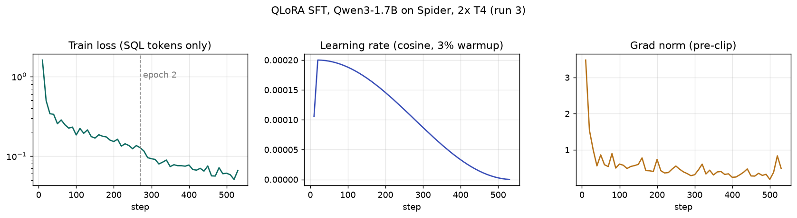

# Week 1: Baseline and QLoRA fine-tuning

**Goal:** Prove the stack runs on a free Kaggle T4. Measure how well stock Qwen3-1.7B writes SQL, then fine-tune it with QLoRA and measure again. Every later week (quantization, serving, deployment) starts from the model produced here.

**Status: done.** Stock Qwen3-1.7B scores **55.9%** execution accuracy on Spider dev. After QLoRA SFT (77 min on 2× T4) it scores **64.6% (+8.7 points)**. It took four Kaggle runs to get there; the failures and their fixes are in the [run history](#run-history).

---

## What I built and why

| Piece | File | Why |
|---|---|---|
| Pinned, checksum-verified data download | [scripts/get_spider.py](../../scripts/get_spider.py) | The Hub's `xlangai/spider` has no SQLite databases, so execution accuracy is impossible with it. I pinned a re-host of the official zip to a commit and check its sha256, so Kaggle and local runs see identical bytes. Extraction rejects `..` and absolute paths (zip-slip). |
| Execution-accuracy evaluator | [evaluation/spider.py](../../evaluation/spider.py) | Compares the *rows* returned by predicted vs gold SQL, as a multiset (order matters only if the gold query has `ORDER BY`). DBs open read-only and a progress handler kills runaway queries after 5 s. |
| Data audit | [evaluation/spider_audit.py](../../evaluation/spider_audit.py) | Measures things before spending GPU hours: split overlap, gold-query health, token lengths under the real chat template, shared-prefix ratio. Several training decisions below come straight from it. |
| One prompt format for train, eval and serving | [finetune/prompt.py](../../finetune/prompt.py) | A train/serve prompt mismatch silently costs accuracy. Schema goes first so all questions on one database share a prefix (pays off with prefix caching in Week 3). Qwen3's thinking mode is turned off. |
| QLoRA SFT | [finetune/train_sft.py](../../finetune/train_sft.py) | 4-bit NF4 frozen base + LoRA r=32 on all linear layers, completion-only loss, fp16, DDP on 2×T4. |
| LoRA merge | [finetune/merge.py](../../finetune/merge.py) | One deployable checkpoint for Week 3 quantization. Merges into the **fp16** base, not the 4-bit one. |
| Kaggle notebook | [notebooks/week1_kaggle.ipynb](../../notebooks/week1_kaggle.ipynb) | Thin launcher: every step is a repo command, so results are reproducible outside the notebook. Ends by zipping results for download. |
| CLI launcher | [scripts/kaggle_run.py](../../scripts/kaggle_run.py) | Runs the notebook on Kaggle GPUs from the laptop. Code ships as a private dataset built from `git archive HEAD`, and the run records the commit, so every result traces to exact code. |
| MLflow hooks | [tracking/](../../tracking/__init__.py) | Training curves through the HF Trainer callback and one run per eval. No-op without `MLFLOW_TRACKING_URI`. |

### Key decisions

| Decision | Why | Alternative considered |
|---|---|---|
| Qwen3-1.7B | Fits a T4 for QLoRA and fp16 serving with room for KV cache. Qwen3-0.6B shares its tokenizer, so it can be the draft model for speculative decoding in Week 3. | Qwen2.5-1.5B: older; 4B: too slow to iterate within 30 GPU-h/week. |
| Spider text-to-SQL | Execution accuracy is objective and cheap, which makes the Week 3 speed-vs-quality trade-off credible. | Open-ended chat: needs an LLM judge, noisy. |
| QLoRA, not full fine-tuning | Full fine-tuning a 1.7B model with Adam needs about 16 bytes per parameter (≈27 GB) before activations. That doesn't fit 16 GB. QLoRA trains about 1% of parameters on a 4-bit frozen base. | LoRA on an fp16 base: fits, but leaves less memory for batch size. |
| fp16 everywhere | T4 (compute capability 7.5) has no bf16. Qwen3 ships bf16 weights, so overflow is a real (small) risk to watch in the loss. | bf16 would need an A100/L4, which isn't free. |
| SDPA attention | FlashAttention-2 needs compute capability 8.0+. | — |
| **Drop** examples over 2,048 tokens, don't truncate | The SQL answer is at the end of each sequence. Right-truncation would cut it off, teaching broken SQL or giving zero loss. Only 82 of 8,659 examples (0.95%) are affected. | Raise max_len to 2,400: slower for every batch, to save 1% of data. |
| Train on `train_spider` + `train_others` (8,659) | Standard Spider training set. The extra 1,659 come from other domains and add diversity. | Only `train_spider` (7,000). |
| `group_by_length` | Prompt lengths range from about 100 to 2,000 tokens. Batching similar lengths cuts padding compute. | Padding-free packing needs FlashAttention, so it's unavailable on T4. |
| Thinking mode off | Qwen3 otherwise emits `<think>…</think>` reasoning first. That multiplies output length, and with it every latency number. | Keep thinking: possibly more accurate, but far slower to serve. |

---

## Results: local measurements (done)

From [reports/week1/spider_audit.json](../../reports/week1/spider_audit.json), using the Qwen3-1.7B tokenizer:

| Measurement | Value | What it means |
|---|---|---|
| Train / dev size | 8,659 (7,000 + 1,659) / 1,034 | — |
| Databases: train / dev / **dev seen in train** | 146 / 20 / **0** | Dev measures generalization to **unseen schemas**, the hard, realistic setting. |
| Dev gold queries that fail to execute | 0 / 1,034 | The evaluator and data are consistent. |
| Gold-vs-gold execution accuracy | 100% | Sanity check on the scorer. |
| Dev gold queries with **empty result** | 49 (4.7%) | A wrong query that also returns nothing scores as correct, so execution accuracy slightly over-credits. Report it as a known caveat. |
| Dev gold with `ORDER BY` | 237 (22.9%) | These are compared with order; the rest as multisets. |
| Train tokens per example: p50 / p95 / p99 / max | 467 / 1,232 / 1,638 / 2,321 | max_len 2,048 covers 99% of examples. |
| Train examples over 2,048 tokens | 82 (0.95%) | Dropped, not truncated (see above). |
| Dev prompt tokens: p50 / p95 / max | 293 / 897 / 919 | Serving needs `max_model_len` of only about 1,024 + output, which leaves more KV cache for concurrency. |
| Dev SQL completion tokens: p50 / p99 / max | 23 / 99 / 131 | `max_tokens=256` at generation is safe. |
| **Shared per-database prefix** (system + schema) | **91.6%** of each dev prompt | Strong Week 3 hypothesis: prefix caching should cut prefill work and TTFT sharply on realistic traffic. |
| Train prompt == inference prompt | true | SFT rows rendered with the same template the server uses (byte-identical). |
| EOS token / pad token | `<|im_end|>` / `<|endoftext|>` | EOS matches the chat template's turn end, and pad ≠ EOS, so the stop token isn't masked out of the loss. |

Unit tests: 22 passing (`pytest -q`). They cover scorer edge cases, runaway-query timeout, read-only DBs, SQL extraction, and dropping over-length examples.

## Results: GPU runs (Kaggle T4)

Baseline and fine-tuned numbers are from **run 4** (commit `31999b9`); training is from **run 3** (commit `71dc390`). Raw files: [reports/week1/run3/](../../reports/week1/run3/), [reports/week1/run4/](../../reports/week1/run4/).

### Headline

| Model | Exec accuracy (dev, 1,034) | Valid SQL | Generation time, 1,034 questions |
|---|---|---|---|
| Qwen3-1.7B (stock, fp16) | **55.9%** | 87.6% | 56 s |
| Qwen3-1.7B + QLoRA SFT (merged, fp16) | **64.6%** | 86.8% | 51 s |
| **Change** | **+8.7 points** (+15.6% relative) | −0.8 points | — |

The plan's target was +10 points; this is **+8.7**. The gap is explained below (schema linking), and the next lever is clear.

### Setup and training facts

| Item | Value |
|---|---|
| Hardware | 2× Tesla T4 (15,360 MiB, compute capability 7.5), driver 580, CUDA 12.8 |
| Stack | vllm 0.19.0, torch 2.10.0, transformers 4.57.6, trl 1.17.1, peft 0.20.0, bitsandbytes 0.50.2 |
| vLLM attention backend | TRITON_ATTN (FlashInfer fails to JIT-link on Kaggle; FlashAttention-2 needs compute capability 8.0+) |
| SFT data | 8,577 kept, 82 dropped (> 2,048 tokens), matching the local audit exactly |
| Trainable params | 34,865,152 (rank 32 × 7 projections × 28 layers; ≈2% of 1.7B). They loaded as **bf16** and were upcast to fp32 (see run 2) |
| Batch / steps / epochs | 2 GPUs × 4 × 4 grad-accum = 32 effective; 538 steps; 2 epochs |
| Wall-clock | **77 min** (4,633 s), 3.7 samples/s, 9.03 M tokens processed |
| Loss | 1.61 → 0.066 (average 0.166); final mean token accuracy 98.2%; grad norm stable at 0.3–0.8 after warm-up, no NaN/overflow in fp16 |
| Peak GPU memory | Not recorded: MLflow was off, so no system metrics. Fix for Week 2: log `torch.cuda.max_memory_allocated()` |



The loss **drops in a step at the epoch-2 boundary** (≈0.13 → 0.09). That's the second pass over the same examples: part of the late loss decrease is memorization, which is why train loss (98% token accuracy) says little about dev accuracy (64.6%) on unseen schemas.

### Where the gain came from

From [reports/week1/base_vs_sft.json](../../reports/week1/base_vs_sft.json) ([evaluation/compare.py](../../evaluation/compare.py)). The complexity buckets are a keyword proxy for Spider's official hardness levels, so treat them as indicative.

| Query type (proxy) | n | Base | SFT | Change |
|---|---|---|---|---|
| simple | 333 | 79.9% | 85.3% | +5.4 |
| GROUP BY / ORDER BY | 211 | 54.5% | 70.1% | **+15.6** |
| nested / set-op | 159 | 31.4% | 47.8% | **+16.4** |
| JOIN | 151 | 51.0% | 54.3% | +3.3 |
| JOIN + GROUP/ORDER | 180 | 38.9% | 43.3% | +4.4 |

**Flip matrix:** 508 both right, **160 fixed** by SFT, **70 broken** by SFT, 296 both wrong. The net +90 hides a lot of churn: SFT changed the model's behaviour, not just patched its errors.

**Why it falls short: schema linking.** "no such column" errors *rose* from 108 to 125. The fine-tuned model adopted the gold-SQL **style** of Spider (`T1`/`T2` aliases, terse lowercase), and with it a **naming prior from the 146 training schemas** that sometimes overrides the schema in the prompt:

- `pets_1`: writes `pet_type` (training-style snake_case) where the real column is `PetType`, and `age` instead of `pet_age`.
- `world_1`: writes `T1.ContinentId` where the column is `ContId`.
- `concert_singer`: aliases `T2` to `singer_in_concert`, then selects `T2.Name`, which belongs to `singer`.

The base model writes verbose, fully qualified SQL that copies identifiers verbatim. So it links schemas better, but it reasons worse about aggregation and nesting. **SFT improved the logic and hurt the grounding.** Next steps, in order of cost:
1. **Execution-guided retry** (inference-only, no retraining): run the SQL; on an error, feed the SQLite error back to the model for one retry. Directly targets the 125 "no such column" failures.
2. **Schema-grounding augmentation:** randomly rename columns and tables in the training schemas, so the model must read identifiers from the prompt instead of recalling them.
3. **Constrained decoding:** restrict identifier tokens to names in the schema (vLLM structured outputs).

### Measurement noise and significance

The stock model was evaluated twice (runs 3 and 4) with identical code, greedy decoding and seed: **56.1% vs 55.9%**. Four questions flipped (1 fixed, 3 broken). Greedy decoding in batched fp16 isn't bit-deterministic: batch composition changes reduction order in the kernels, and near-ties in the logits can flip. **Noise floor ≈ ±0.3 points**, so in Week 3 a quantized model within ~0.5 points of fp16 counts as "no measurable loss".

**Is +8.7 real?** Yes. Both models answered the same 1,034 questions, so the test is a paired one. **McNemar's test** on the discordant pairs (160 fixed vs 70 broken) gives χ² = 34.4, p ≈ 4×10⁻⁹. A paired bootstrap gives a **95% CI of +5.8 to +11.5 points**. The +10 target sits inside that interval, so the miss is within sampling uncertainty.

### Run history

| Run | Commit | Outcome | Cause / fix |
|---|---|---|---|
| 1 | b849d6a | Failed after ~2 min (no GPU work done) | Kaggle auto-unpacks an uploaded `.tar` into `src/`, so the notebook found the commit marker but copied an empty folder. Every module import then failed. Fix: locate the code via `pyproject.toml`. Setup now fails fast unless the repo and training deps import, and the results cell always writes a zip. |
| 2 | 65d2d7f | All steps failed, ~20 min of GPU | Three separate problems. (a) vLLM 0.19 picked the **FlashInfer** attention backend, which JIT-compiles kernels on first use and failed to link on Kaggle (`ld: cannot find -lcuda`). Fix: `attention_backend="TRITON_ATTN"`, which needs no build step, plus the FlashInfer sampler off. (b) The SFT smoke run was one process seeing two GPUs, so Trainer wrapped the model in `nn.DataParallel`, which SFTTrainer rejects. Fix: `CUDA_VISIBLE_DEVICES=0` for single-process runs. (c) DDP training crashed in the fp16 GradScaler (`_amp_foreach_non_finite_check_and_unscale_cuda not implemented for 'BFloat16'`): trainable LoRA weights were bf16, Qwen3's checkpoint dtype. Fix: upcast trainable params to fp32 (fp32 master weights are standard for fp16 AMP) and set `bf16=False`. Also: steps are now gated, so a failure skips its dependants and `status.json` records what ran. |
| 3 | 71dc390 | vLLM smoke, **baseline eval, SFT smoke and full SFT passed**; merge failed, so the fine-tuned eval was skipped (~1 h 35 min) | The Kaggle image ships `torchao` 0.10. PEFT 0.20, when loading a LoRA adapter onto a *plain* fp16 model, checks torchao and **raises** on versions below 0.16. Training never hit this: its 4-bit base takes PEFT's bitsandbytes path. Fix: uninstall torchao, and add a **merge smoke test** on the 64-example adapter so merge breakage surfaces before training. The trained adapter (140 MB = 34.87 M fp32 params) was recovered from the kernel output and reattached for run 4, so no retraining. |
| 4 | 31999b9 | **All steps passed** (~25 min; training reused from run 3) | Uploaded run 3's adapter with `kaggle_run.py --attach`; the notebook skipped training, merged, and evaluated. The baseline re-ran as a free reproducibility check: 55.9% vs 56.1% in run 3. |

Kaggle image facts observed in runs 1–2: Python 3.13, torch 2.11.0+cu128, transformers 5.16.1, peft 0.20.0, accelerate 1.14.0, driver 580, 2× Tesla T4 (15,360 MiB, compute capability 7.5). vLLM, TRL and bitsandbytes are not preinstalled. `pip install vllm` resolved to **0.19.0** (not the latest 0.32), downgrading torch to 2.10.0 and transformers to 4.57.6. These versions are now pinned in `requirements-gpu.txt`. vLLM on T4 offered FLASHINFER, TRITON_ATTN and FLEX_ATTENTION; FlashAttention-2 was rejected (needs compute capability 8.0+). **`torch.cuda.is_bf16_supported()` returns True on the T4**, but the T4 has no bf16 hardware and runs it through slow emulation. So the code sets fp16 explicitly and never trusts that check.

---

## Bugs and gotchas caught this week

1. **Truncation would have trained on cut-off SQL.** The audit showed 1% of examples over 2,048 tokens. TRL truncates from the right, where the answer is. Fix: drop them, with a unit test.
2. **4-bit models + DDP.** A bitsandbytes 4-bit model can't be moved after loading. Without `device_map={"": LOCAL_RANK}` both processes load onto GPU 0 or crash. Gradient checkpointing with DDP + PEFT also needs `use_reentrant=False` and `ddp_find_unused_parameters=False`.
3. **Qwen3 thinking mode is on by default.** I pass `enable_thinking=False` to the chat template. The template then inserts an empty `<think>\n\n</think>` block, and the audit verified that train and serve prompts both contain it.
4. **Token-boundary bug in the benchmark prompt generator** (written for Week 2, caught by a unit test). Decoding prefix and suffix separately, then joining strings, merges tokens at the seam and changes the prompt length. Fix: concatenate token IDs, decode once.
5. **Spider on the Hub has no databases.** Execution accuracy needs the SQLite files, hence the pinned zip.
6. **Three ways a working T4 recipe broke on a new software stack (run 2):** an attention backend that JIT-compiles kernels, `nn.DataParallel` silently kicking in when two GPUs are visible, and bf16 trainable weights under fp16 AMP. Each is a classic production failure: *the default changed under you*. Pin versions and backends explicitly.
7. **A smoke test must cover every stage, not just the first.** Run 3 trained successfully for 77 minutes, then failed at the merge step, which no smoke test had exercised. The pipeline now merges the 64-example smoke adapter before the real training starts.
8. **Kaggle unpacks uploaded archives.** The first remote run lost its code to this (see run history). Lesson: launch scripts must fail fast on setup, and results collection must never be the step that crashes.

---

## Interview Q&A

**Why execution accuracy rather than exact match?**
Many different SQL strings are correct (`count(*)` vs `count(id)`, join order). Exact match punishes correct answers. Execution accuracy runs both queries and compares rows. Its weakness is false positives: a wrong query can return the same rows by coincidence. That's why I measured the empty-result rate (4.7%).
*Spoken:* "Exact match punishes correct answers written differently. So I run both queries and compare result rows. I report its known false-positive weakness, about 5% of gold queries return empty results."

**Why QLoRA? What exactly is quantized?**
Only the frozen base weights are stored in 4-bit NF4. In each forward pass they're dequantized to fp16 for the matmul. The LoRA matrices (A, B; rank 32 on q/k/v/o/gate/up/down) train in higher precision. Memory: about 1.5 GB (4-bit linear layers plus the fp16 embedding table, which bitsandbytes doesn't quantize) instead of 3.4 GB in fp16, plus small adapter optimizer state. Full fine-tuning would need about 27 GB just for weights, gradients and Adam state.
*Spoken:* "The frozen base is stored in 4-bit and dequantized on the fly. Only about 1% of parameters, the LoRA adapters, get gradients. That's what makes a 1.7B model trainable on a 16 GB T4."

**Why merge into the fp16 base instead of the 4-bit base?**
The 4-bit weights are an approximation. Merging into them bakes NF4 rounding error into the deployable model, and Week 3 then quantizes it a second time, compounding the error. Merging into the original fp16 weights keeps one clean checkpoint as the source for every compressed variant.

**Why completion-only loss?**
The prompt is about 92% schema that the model only has to read, not produce. Loss on prompt tokens would spend capacity on memorizing schemas and dilute the gradient from the SQL we care about.

**How do you know train and serve prompts match?**
Both go through one function (`finetune/prompt.py`). The audit checks that prompt + completion equals the chat template's own rendering of the full conversation, byte for byte.

**Why is dev schema overlap zero, and why does it matter?**
Spider splits by database. Dev tests whether the model can read a schema it has never seen, the realistic deployment case. A high score can't come from memorizing table names.

**What would you do with more compute?**
Full fine-tuning or a larger rank; a 4B base; DPO on execution-verified preference pairs (correct vs incorrect SQL from the model's own samples); self-consistency (sample N queries, pick the most common execution result).

**What's the biggest risk in the setup?**
fp16 overflow, since Qwen3 is trained in bf16 and the T4 can't do bf16. Watch for loss spikes or NaN. Mitigations: lower LR, keep the fp16 loss scaler, or move the LoRA computation to fp32.

---

### Results Q&A

**SFT gained 8.7 points. How do you know it's real and not noise?**
I measured the noise floor by running the same baseline twice: 0.2 points apart. Then I tested the gain properly. It's a paired comparison on the same questions, so McNemar's test applies: 160 questions fixed vs 70 broken gives p ≈ 4×10⁻⁹. The bootstrap 95% CI is 5.8 to 11.5 points.
*Spoken:* "Same questions, so a paired test: McNemar's on 160 fixed versus 70 broken gives p around 10⁻⁹, and the bootstrap CI is about 6 to 11.5 points. I also re-ran the baseline to measure run-to-run noise, which was 0.2 points."

**Why only +8.7 when train token accuracy is 98%?**
Train accuracy is on schemas the model has seen; dev uses 20 schemas it has never seen. Error analysis showed the gain came from query *logic*: aggregation +15.6 and nesting +16.4 points. Meanwhile *schema linking* got worse ("no such column" errors went from 108 to 125), because the model learned a naming prior from the training schemas and sometimes ignored the prompt's actual column names.
*Spoken:* "It learned SQL structure well, but it also learned what column names usually look like in Spider's training databases. On unseen schemas it sometimes writes `pet_type` when the column is `PetType`. That's a grounding problem, and I'd attack it with execution-guided retry and column-renaming augmentation."

**Why is greedy decoding not reproducible?**
Batched fp16 inference isn't bit-deterministic. Which requests share a batch changes the reduction order inside matmul and attention kernels, so logits differ in the last bits, and near-ties flip the argmax. That's 4 of 1,034 questions here. In practice: measure the noise floor and don't report differences below it.

**Why did the fine-tuned model generate faster (51 s vs 56 s)?**
It learned Spider's terse SQL style (`T1`/`T2` aliases, no line breaks), so its outputs are shorter. Decode time scales with output tokens.

## Reproduce

```bash
# local (CPU): data + audit + tests
python scripts/get_spider.py --out data
python -m evaluation.spider_audit --spider-dir data/spider_data --out reports/week1/spider_audit.json
pytest -q

# Kaggle, from this machine: uploads HEAD as a private dataset, runs on T4 x2, fetches results
python scripts/kaggle_run.py run --week 1        # -> reports/week1/kaggle/results/
# or by hand: import notebooks/week1_kaggle.ipynb on kaggle.com (GPU T4 x2, internet on), run all
```
