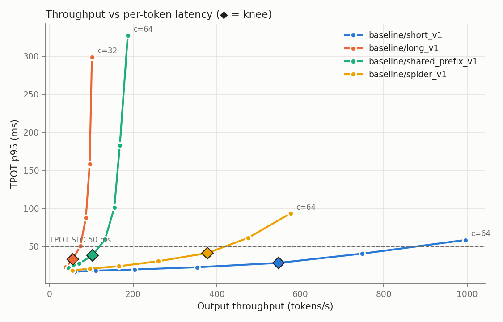
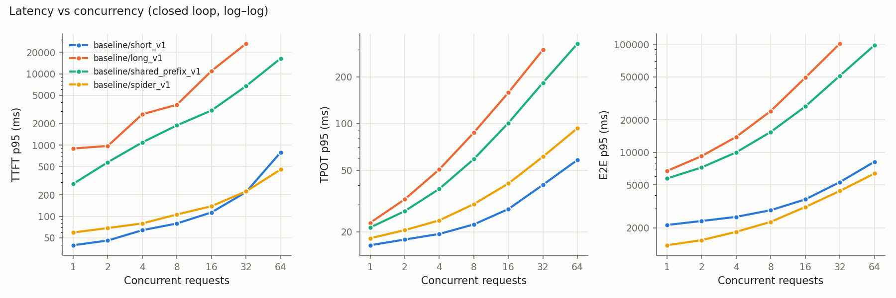

# Week 2: Benchmark harness and capacity math

**Goal:** Measure how the Week 1 fine-tuned model (fp16, vLLM, one T4) behaves under load: where throughput stops scaling, what latency each load level costs, and how many users one GPU can serve within an SLO. Every Week 3 optimization is reported as a change against these numbers.

**Status: done.** One T4 serves the Spider workload at **8 concurrent requests (8.3 req/s, ≈30k queries/hour)** within the SLO, and short chat-style prompts at 32 concurrent (750 output tok/s). The big finding: **decode time is dominated by the attention kernel, not the weights, once context adds up.** vLLM's Triton attention reads the KV cache at ~11% of the T4's bandwidth. The KV-cache prediction matched vLLM's own figure to within 0.8%. Predictions were written down before the run; results follow them.

---

## What I built and why

| Piece | File | Why |
|---|---|---|
| Async streaming load generator | [bench/client.py](../../bench/client.py) | Speaks the OpenAI `/v1/completions` API, so the same client measures vLLM, llama.cpp and the Week 4 gateway. Closed loop (N in flight) gives capacity curves. Open loop (Poisson arrivals) shows queueing, which closed loop hides because the client waits for a reply before sending more. |
| Metric definitions | [bench/metrics.py](../../bench/metrics.py) | TTFT, ITL, TPOT, E2E, p50/90/95/99. TPOT uses the server's token count because one SSE chunk can carry several tokens. |
| Frozen workloads | [bench/workloads.py](../../bench/workloads.py), [configs/workloads.yaml](../../configs/workloads.yaml) | short (128/128), long (2048/256), shared-prefix (1024 of 1536 tokens shared), and Spider (300 real dev questions in the exact serving format, natural output length). Exact token counts verified after re-tokenization; sha256 manifest per run. |
| Server-side sampling | [bench/server_metrics.py](../../bench/server_metrics.py) | Polls vLLM `/metrics` and `nvidia-smi` every second during each load level: KV-cache usage, running/waiting requests, preemptions, prefix-cache hit rate, GPU memory. This explains *why* latency bends, not just that it does. |
| Server launcher | [bench/server.py](../../bench/server.py), [configs/serving.yaml](../../configs/serving.yaml) | vLLM flags live in named profiles, with defaults spelled out. Week 3 ablations override one flag (`--set enable-prefix-caching=false`). Parses vLLM's reported KV capacity from its startup log. |
| KV-cache calculator | [bench/kv_cache.py](../../bench/kv_cache.py) | Predicts capacity from `config.json` before running anything. |
| Capacity report | [bench/report.py](../../bench/report.py) | Knee, max concurrency under SLO, Little's-law check, plots. |
| Kaggle notebook | [notebooks/week2_kaggle.ipynb](../../notebooks/week2_kaggle.ipynb) | Merges the Week 1 adapter, serves on one T4, runs all sweeps, open-loop sweep, and the `vllm bench serve` cross-check. |

### Key decisions

| Decision | Why |
|---|---|
| One T4, TP=1 | This is the unit of capacity. TP=2 vs two replicas is a Week 3 experiment. |
| `ignore_eos` on synthetic workloads, natural length on Spider | Fixed output length compares configs on equal work. Natural length is what production sees. |
| Knee = max of throughput / latency (Kleinrock's power) | A definition that doesn't need eyeballing. Past the knee, extra load buys less throughput than it costs in latency. |
| SLO capacity = highest level where it *and every lower level* pass | One lucky pass above a failing level isn't capacity. |
| SLOs fixed in config before the run | Picking thresholds after seeing the curves would make "meets SLO" meaningless. |
| Client cross-checked with `vllm bench serve` | An independent tool on the same server. If they disagree by more than ~10%, my client is the bottleneck or mismeasures. |

---

## Predictions (written before the run)

**KV cache.** Qwen3-1.7B: 28 layers, 8 KV heads (GQA, vs 16 query heads), head dim 128.
bytes/token = 2 (K, V) × 28 × 8 × 128 × 2 B = **114,688 B = 112 KiB**.
Budget ≈ 0.9 × 15 GiB − 3.8 GiB weights − ~1 GiB activations ≈ 8.7 GiB → **~81k tokens**, so **~19 concurrent 4k sequences, ~4 at 16k**. vLLM reports its own figure at startup; the gap measures my activation guess.

**Decode floor.** At batch 1, each token reads every weight once: ~4.06 GB / 320 GB/s (T4 peak) ≈ **12.7 ms/token**. Expect ~16–20 ms in practice (60–80% of peak bandwidth).

**Why batching is nearly free at first.** One weight read serves the whole batch, so arithmetic intensity is about B FLOP/byte at batch B. The T4's ridge point is ~65 TFLOPS / 320 GB/s ≈ 200 FLOP/byte, so decode stays memory-bound far past any batch the KV cache allows. Expect output throughput to scale nearly linearly with concurrency at first, then bend as per-request KV reads grow and prefills interrupt decode. That bend sets the knee, not compute.

**Workload ordering.** long_v1 knees first (2k-token prefills stall decode; ~40 such sequences fill the cache). shared_prefix_v1 should beat long_v1 at the same length, because prefix caching is on and 2/3 of each prompt is cached.

---

## Results

Run 2 ([reports/week2/run2/](../../reports/week2/run2/)): fine-tuned Qwen3-1.7B, fp16, vLLM 0.19.0, Triton attention, one Tesla T4, all 13 steps passed. Every sweep had 0 errors and 0 preemptions.

### Capacity

| Workload | Peak out tok/s (c) | Knee c | Max c under SLO | At SLO: out tok/s, req/s | Binding SLO at the next level | Peak KV use |
|---|---|---|---|---|---|---|
| short_v1 (128/128) | 995 (64) | 16 | **32** | 749, 5.85 | TPOT p95 58 ms, TTFT p95 790 ms | 19% |
| spider_v1 (real) | 577 (64) | 16 | **8** | 260, 8.33 | E2E p95 3.11 s (limit 3.0) | 11% |
| shared_prefix_v1 (1536/256) | 187 (64) | 4 | **2** | 71, 0.28 | TTFT p95 1.09 s | 58% |
| long_v1 (2048/256) | 101 (32) | 2 | **2** | 56, 0.22 | TTFT p95 2.7 s, TPOT p95 50.5 ms | 85% |

**SLOs: kept as pre-registered.** Each one binds somewhere, and each sits where its rationale says. Spider misses c=16 by 4% on E2E; loosening the limit to let it pass would be fitting the SLO to the data.

### Predictions vs measurements

| Prediction | Measured | Verdict |
|---|---|---|
| KV cache 112 KiB/token, ~81k tokens | vLLM: **86,400 tokens**, 21.1× max concurrency at 4k. My calculator with the *measured* weights (3.2 GiB, not my 3.8 GiB guess: Qwen3-1.7B ties the embedding and LM head) gives 87,069: **0.8% off**. vLLM reserved 1.07 GiB for activations + CUDA graphs vs my 1.0. | ✅ The capacity model works; the error was my weight-size guess. |
| Decode floor ~12.7 ms/token; 16–20 ms in practice | **16.4 ms** at c=1 (short). Weights are 3.44 GB, so the floor is 10.7 ms: the weight read runs at ~65% of peak bandwidth. | ✅ |
| Throughput near-linear at first, knee from memory/scheduling, not FLOPs | Near-linear to c=8 on short (61 → 353 tok/s, 5.8× for 8×). But the knee comes from **attention**, not from KV capacity: KV use peaked at 11–19% on short/spider. | ⚠️ Right mechanism class, wrong component. See below. |
| long_v1 knees first; shared_prefix beats long | long knees at c=2, shared_prefix at c=4. Prefix hit rate on shared_prefix: **66.6%** (= 1024/1536, exactly the shared part); TTFT at c=1 **283 ms vs 889 ms**. | ✅ |

### Main finding: attention, not weights, sets the per-token cost

Plotting the median TPOT of all 27 closed-loop points against the total context the batch holds (concurrency × mean context length) gives a straight line:

**TPOT ≈ 17.7 ms + 3.2 ms per 1k context tokens in the batch** (R² = 0.97)

- **17.7 ms** is the per-step weight read. Every request shares it, which is why batching helps.
- **3.2 ms per 1k tokens** is attention reading the KV cache: 112 KiB per token in 3.2 µs is **~36 GB/s, about 11% of the T4's 320 GB/s**.
- It isn't prefill interference. At c=1, where no other request can interrupt, long_v1 decodes 6.4 ms slower than short_v1 for 2k more context: the same slope.

At c=32 on long_v1 the batch holds ~70k context tokens, so attention costs ~220 ms per step against ~18 ms for the weights. That's why TPOT reaches 294 ms with the KV cache still not full.

**Week 3 implications (test, don't assume):**
1. **W4A16 quantization only shrinks the 17.7 ms term.** It helps short/spider at low concurrency and does almost nothing for long contexts. And without Marlin kernels on sm75, AWQ/GPTQ dequantization may cost more than the bandwidth it saves.
2. **The attention backend is a first-class experiment.** Compare TRITON_ATTN with FLEX_ATTENTION, and FlashInfer if its JIT can be made to link. This targets the dominant term.
3. **KV-cache tuning (`gpu-memory-utilization`, fp8 KV) won't help spider:** it uses 11% of the cache.
4. **TP=2 halves both terms per GPU.** On long contexts it may beat two replicas; on spider, replicas should win.

### Long prompts: why requests queue with half the cache free

long_v1 at c=16 had up to 13 requests waiting with KV use at 43%. A 2,048-token prefill takes ~0.9 s on the T4 (~8 effective TFLOPS, about 12% of fp16 peak; whether attention is to blame here too needs a profiler). Chunked prefill interleaves each prefill with the running decodes, so new requests wait for prefill time, not memory. TTFT p95 goes from 0.9 s (c=1) to 11 s (c=16) to 27 s (c=32).

### Open loop: Poisson arrivals on spider

| Offered req/s | Achieved | TTFT p95 | TPOT p95 | E2E p95 | Meets SLO |
|---|---|---|---|---|---|
| 4.6 | 4.4 | 91 ms | 28 ms | 1.87 s | ✅ |
| 9.2 | 8.5 | 129 ms | 43 ms | 2.78 s | ✅ |
| 13.9 | 11.9 | 178 ms | 57 ms | 3.65 s | ❌ |
| 22.2 | 16.1 | 304 ms | 94 ms | 5.59 s | ❌ |

- **SLO capacity is about the same under realistic traffic: ~9 req/s** (closed loop: 8.3).
- **At equal throughput, Poisson traffic is worse.** At ~12 req/s, TPOT p95 is 57 ms open-loop vs 41 ms closed-loop: random bursts briefly push the batch above its average.
- **This sweep never overloaded the server.** Rates were set relative to the c=64 closed-loop peak, but c=64 wasn't saturation (no request ever waited, KV 11%). The expected queueing blow-up near utilization 1 wasn't reached; Week 3 should extend the rates. Achieved < offered because 300 requests end before the system reaches steady state, and the drain counts in the wall time.

### Cross-check against `vllm bench serve` (random 128/128)

| c | Output tok/s (mine / vLLM) | TPOT p50 (mine / vLLM) | TTFT p95 (mine / vLLM) |
|---|---|---|---|
| 1 | 61 / 59 (+4%) | 16.4 / 16.9 ms | 39 / 40 ms |
| 8 | 353 / 306 (+15%) | 22.3 / 23.0 ms | 79 / 92 ms |
| 32 | 749 / 720 (+4%) | 39.9 / 41.5 ms | 219 / 261 ms |

TPOT agrees within 4% at every level, so the client measures decode correctly. The c=8 throughput gap comes from vLLM's run: its *mean* TTFT (420 ms) exceeds its p95 (92 ms), so a few requests stalled for seconds. My TTFT is consistently lower, and the next section explains why.

### Measurement flaw found: the prefix cache leaked across levels

short_v1 prompts share nothing, yet its prefix hit rate was **87.5%** from c=2 on. Every level replays the same 200 prompts, so vLLM served later levels from the cache filled by earlier ones (7 of each prompt's 8 blocks; the last block is always recomputed). At c=1 the rate was 4.3% = 10 warm-up prompts / 200 × 7/8, which confirms the mechanism.

- **Affected:** TTFT on short_v1 and spider_v1 reads low (vLLM's tool, with fresh prompts, saw 19% higher TTFT p95 at c=32). Throughput and TPOT barely move: these prefills are short.
- **Not affected:** long_v1 (hit rate 0%: 205k prompt tokens don't fit in 86k of cache, so LRU evicts each prompt before its reuse) and shared_prefix_v1 (66.6% = only the intended share).
- **Fix:** the client now calls vLLM's `/reset_prefix_cache` before every level and records `prefix_cache_reset` in the summary. Week 3 re-measures this baseline in the same session as its experiments, with the fix in place, before comparing anything to it.

Two smaller caveats:
- **The client shares 4 CPUs with vLLM.** The Little's-law ratio fell to 0.83 at spider c=64 (18 req/s), so the client may lag slightly at the highest request rates.
- **Every number comes from one run on one Kaggle machine.** Week 1 put run-to-run noise at ±0.3 points for accuracy; latency noise isn't measured yet.

### Run history

| Run | Commit | Outcome | Cause / fix |
|---|---|---|---|
| 1 | 53d9507 | Merge failed after ~20 min; everything else skipped | The adapter glob matched `reports/week1/run3/adapter_config.json` from the code dataset (config, no weights), and PEFT then treated the path as a Hub repo id. Fix: match `adapter_model.safetensors`. |
| 2 | 56e79b7 | **All 13 steps passed** (2 h 27 min) | The numbers above. |

---

## Interview Q&A

**Why is decode memory-bound, and what does batching buy?**
Each decode step reads all the weights to produce one token per sequence. At batch 1 that's 3.4 GB for ~3.4 GFLOP, about 1 FLOP per byte, far below the T4's ridge point of ~200. Batching reuses the one weight read for every sequence, so throughput rose 5.8× from c=1 to c=8 while TPOT grew only 36%.
*Spoken:* "One decode step reads every weight to produce one token per sequence, so it's bandwidth-bound. Batching shares that read: 8 concurrent requests gave almost 6× the throughput for a third more latency."

**Your knee wasn't where the KV cache filled up. What was it?**
Attention. TPOT fits 17.7 ms + 3.2 ms per 1k tokens of batch context with R² 0.97. The second term is the paged-attention kernel reading the KV cache at ~11% of peak bandwidth. On long prompts it dominates long before memory runs out.
*Spoken:* "I fit step time against total context in the batch and got a clean line: a fixed weight cost plus a per-token attention cost. The attention kernel on T4 runs at about a tenth of peak bandwidth, so at 32 long requests it's 90% of the step time. That told me weight quantization alone won't fix long-context latency."

**Closed loop vs open loop?**
Closed loop keeps N requests in flight and waits for each, so it can never overload the server; it measures capacity curves. Open loop sends Poisson arrivals independent of responses, like real users. Bursts briefly raise the batch, so at equal average throughput open loop showed 57 ms vs 41 ms TPOT p95.

**How did you know your benchmark client was trustworthy?**
Three checks. An independent tool (`vllm bench serve`) agreed within 4% on TPOT. Little's law (concurrency = throughput × latency) held to 0.83–1.0. And server-side counters explained client-side results, which is how I caught the prefix cache leaking across sweep levels.
